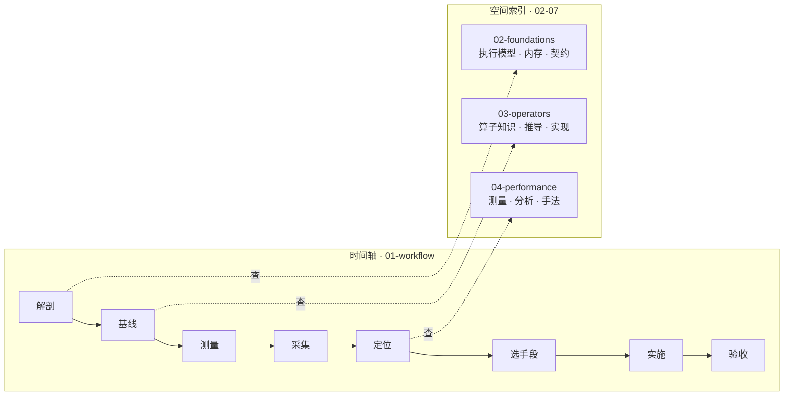

# Op 算子开发知识库

面向有普通开发经验、但没有系统做过 GPU/NPU 算子开发的人。目标不是“读过”，而是能解释正确性、性能和硬件行为，并能审查 AI 生成的实现。

## 30 秒起步

~~~powershell
python 09-practice/check.py show VA01
python 09-practice/check.py grade VA01
~~~

这是一道**有明确对错**的故障题：`student.py` 里是一个有 bug 的向量加法实现，改到判题通过为止。初次运行判题失败是**题目设计**，不是环境装错了。

这两条命令只需要标准 Python——不需要 GPU，不需要 PyTorch。

## 这个仓库怎么组织

一条主线加一个索引，两部分共用同一份内容，不重复维护。

**主线是时间轴**，回答“我现在卡住了，下一步做什么”。九个阶段，每步产出一份证据，下一步只依赖上一步的证据。入口：[流程主线](01-workflow/README.md)。

**知识域是空间索引**，回答“这个概念是什么、这个算子怎么写”。按需直达，不用按顺序读。入口：[目录结构](#目录结构)。

编号是**类型分组**，不是难度梯度。`03-operators/attention` 和 `03-operators/elementwise` 之间没有先后依赖，按 `00 → 99` 硬读会卡在 `02-foundations/contracts/`——那四份是判据清单，是查的，不是读的。

## 按你的情况选入口

| 你的情况 | 从哪进 | 说明 |
|---|---|---|
| **没写过 CUDA，想系统学** | [00-start](00-start/README.md) → [流程主线](01-workflow/README.md) → [算子域](03-operators/README.md) | 先建立线程与内存的心智模型，再顺着九个阶段走完一个算子 |
| **手头有个算子要写** | [决策树](99-reference/decision-tree.md) | 先判断该不该自己写，再找对应算子类别 |
| **想先动手** | [练习层](09-practice/README.md) | 12 个故障题、15 道阅读题、算子五件套、完整模型切片 |

三条路径共用同一份内容。**第一次来，从上面“30 秒起步”那道题开始最省事**——它给你的第一个反馈是“对/错”，而不是“读完了”。

## 目录结构

~~~text
00-start/           入口：前置知识、环境搭建、学习路径
01-workflow/        流程主线：一个算子从需求到交付的九个阶段
02-foundations/     基础域：执行模型、内存层级、索引与布局、精度契约
03-operators/       算子域：按算子类型组织，每类自带知识、推导、实现、反例
04-performance/     性能域：测量、分析、工具链、优化手法、性能反例
05-frameworks/      框架域：算子生命周期、后端接入、测试
06-platforms/       平台域：哪些能力可迁移、迁移时哪些必须重学
07-quantization/    量化域：低精度、量化算法、量化 kernel、精度评估
08-engineering/     交付域：CI、端到端项目
09-practice/        练习层：故障注入、代码阅读、算子故事、模型切片
99-reference/       速查层：术语表、清单、模板、外部资料
assets/             可运行代码与构建入口
~~~

每个阶段页链接到对应知识域，每个知识域页反向标注它服务于哪个阶段。学的时候顺着主线走，查的时候直接进知识域。

## 算子域怎么读

每个算子目录内部结构统一：

~~~text
03-operators/<类别>/<算子>/
  README.md        知识：定义、契约、陷阱、性能要点   ← 查阅入口
  walkthrough.md   推导：手算、数据流、逐段代码       ← 学习入口
  impl/            实现：该算子特有的 CUDA 源码
  case-study.md    五件套：从需求到交付的完整记录     （部分算子有）
~~~

跨算子共享的代码（CPU 教学实验、服务多个算子的 `.cu`、CMake 入口）统一放在 [assets/](assets/README.md)，按语言组织。所以 attention、convolution 等目录没有 `impl/`，它们的实验代码在 `assets/cpu/`。

同一个算子，查的人读 README，学的人读 walkthrough，踩坑的人对照 impl 和反例。

## 没有 GPU 能走到哪一步

**只装标准 Python 就能走完大部分内容。** CUDA 只影响你能不能拿到真实硬件数字，不影响你能不能理解内容。

| 档位 | 需要什么 | 能做什么 |
|---|---|---|
| A | 标准 Python | 故障题、阅读题、CPU 教学实验 |
| B | A + PyTorch（CPU 版即可） | 算子故事实测、模型切片、框架接入实验 |
| C | B + NVIDIA GPU + CUDA Toolkit + CMake | 编译运行 `assets/cuda/` 的 CUDA 示例 |

**一条纪律**：无 GPU 时得到的 CPU 数字，不能用来推断 HBM 带宽、bank conflict、寄存器数或 Tensor Core 利用率——这些量只在设备上才有意义。

逐项的能力矩阵（哪节可完成、哪节只能读、哪节必须等设备）在 [环境与能力矩阵](00-start/environment.md)。

~~~powershell
# A 档：故障注入练习
python 09-practice/check.py list
python 09-practice/check.py show VA01
python 09-practice/check.py grade VA01

# A 档：CPU 教学实验
python assets/cpu/indexing_lab.py
python assets/cpu/softmax_lab.py
python -m unittest discover -s assets/cpu

# B 档：需要 PyTorch
python 09-practice/operator-stories/operator_story.py --output 09-practice/operator-stories/results/local
python 09-practice/model-slice/run.py --profile --output 09-practice/model-slice/results/local
~~~

## CUDA 示例

需要兼容的 NVIDIA GPU、CUDA Toolkit 和 CMake：

~~~powershell
cmake -S assets/cuda -B build/cuda
cmake --build build/cuda --config Release
.\build\cuda\Release\vector_add.exe
.\build\cuda\Release\row_ops.exe --benchmark
ctest --test-dir build/cuda -C Release --output-on-failure
~~~

## 这个仓库不承诺什么

判断一份材料值不值得读，先看它承认什么。

**验证状态**

- `assets/cuda/` 下的 `.cu` 文件**尚未在真实设备上编译验证**——编写本仓的环境没有 nvcc 和 GPU。源码可读、逻辑可推，但“能在设备上编译通过”这件事没有被验证过。
- Triton 教学代码按官方接口编写，同样需要在兼容版本和 GPU 上验证。
- **可以复跑的是这些**：`assets/cpu/` 的 17 项单元测试、故障注入 12 题（39 组输入）、阅读题 15 道、算子故事与模型切片的 CPU 报告。

**内容边界**

- 模拟数据都明确标注为模拟，不代表任何具体硬件的成绩。
- 模型切片使用随机权重，不是预训练语言模型，也没有手写 GPU FlashAttention；报告里的 SDPA 实际走 CPU 路径（事件名是 `_scaled_dot_product_flash_attention_for_cpu`），不是硬件实现。
- 算子域按类型覆盖 elementwise、reduction、normalization、matmul、attention、convolution、fusion、数据搬运，**不是全部算子**。loss、optimizer、random、sequence、vision、sparse、通信算子没有内容。
- 国产加速卡的 API、工具和约束随 SDK/设备变化，以厂商对应版本的官方资料为准。

## AI 辅助的学习方法

AI 能加快样板代码、改写和测试草稿；不能替你判断索引、mask、同步、dtype、数值边界和设备假设，也不能替你测量性能。

用 [AI 审查清单](99-reference/checklists/ai-usage-policy.md) 逐项检查，在 [实验记录模板](99-reference/templates/experiment-log-template.md) 里留下假设和证据。**不要把 AI 写出的性能数字当成实测。**

## 下一步

| 你的位置 | 做什么 |
|---|---|
| 完全不知道从哪开始 | 跑上面“30 秒起步”的两条命令，然后读一遍[流程主线](01-workflow/README.md)——30 分钟，不要停下来查东西 |
| 知道要写哪个算子 | [决策树](99-reference/decision-tree.md) |
| 卡在某个具体问题上 | [术语表](99-reference/glossary.md)、[常见错误](99-reference/common-pitfalls.md) |
| 想找外部资料 | [外部资料索引](99-reference/external-links.md)：CUDA、Triton、Nsight、PyTorch、CUTLASS 和进阶论文 |
