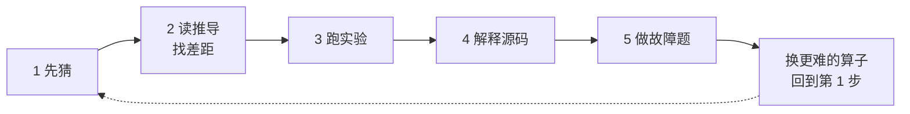

# Op 算子开发知识库

面向没系统做过 GPU/NPU 算子开发的人。

**这份文档不是目录清单，是五轮练习。** 学算子开发最缺的不是“知道学什么”，是**反馈**——所以每一轮都必须有一个能判对错的产出：改对一道题、写对一个 kernel、说出一个瓶颈类别。

想现在就动手，直接跳到[第一轮](#第一轮--vector-add建立映射)。

## 一轮怎么走



五步固定不变，变的是算子。**同一套动作重复五遍，每遍对象更难**——这比“读完 elementwise 再读 reduction”有效，因为每一轮你都有产出。

| 步 | 做什么 | 为什么是这一步 |
|---|---|---|
| **1 先猜** | 动手前先写下：要发多少 block？每个线程干什么？哪一步最容易越界？ | 逼自己调用索引思维。算子开发真正的手艺只有一件：**把“数据的某个位置”翻译成“哪个线程算它”**。翻译错了，编译器不报错，结果只是不对 |
| **2 读推导** | 读 `walkthrough.md`，**对着自己刚才的猜测找差距** | 差距就是你的知识缺口。“我猜错了、错在哪”的收获远大于通读一遍 |
| **3 跑实验** | 跑 `assets/cpu/` 里对应的模拟实验 | 没有 GPU 也能看见数据怎么流动 |
| **4 解释源码** | 读 `impl/` 的 CUDA 源码，**逐行解释每个“看起来多余”的写法** | 解释不出来就是没懂。这一关没有判题器，只能自己诚实 |
| **5 做故障题** | 做到判题通过 | 唯一客观的反馈 |

第 5 步的纪律比题目本身重要：**先写下输入、症状、你的猜测，再动手，最后回看猜对了没有。**

## 五轮

| 轮 | 算子 | 建立的能力 | 故障题 | 过关标志 |
|---|---|---|---|---|
| 一 | vector-add | 线程 ↔ 数据的映射 | VA01–VA04 | 能说出 ceil 除法和越界线程的关系 |
| 二 | reduction | 多线程协作出一个结果 | RD01–RD04 | 能解释同步为什么在 `if` 外面 |
| 三 | softmax / layernorm | 数值稳定 | SM01、LN01 | 能解释为什么要先减最大值 |
| 四 | matmul | 数据复用与测量 | GM01 | 能说出 tiling 换来了什么、代价是什么 |
| 五 | attention | 把前面全部用上 | AT01 | 能解释 prefill 与 decode 的 shape 差异 |

12 道故障题全部落在这五轮里。

---

### 第一轮 · vector-add：建立映射

**先猜**：`n = 1000`，每个 block 256 个线程。要发几个 block？最后一个 block 里有几个线程在真正干活？

猜完再往下。

**读** [walkthrough](03-operators/elementwise/vector-add/walkthrough.md) ｜ **跑** `python assets/cpu/indexing_lab.py`
**解释** [vector_add.cu](03-operators/elementwise/vector-add/impl/vector_add.cu) 里的 `if (i < n)` ｜ **做** `python 09-practice/check.py grade VA01`

**过关**：不看资料能说出 grid 为什么用 `(n + block - 1) / block` 而不是 `n / block`，以及删掉那个 `if` 之后症状长什么样。

**如果你只能回答“这是边界检查”，那还没到。**

---

### 第二轮 · reduction：第一次协作

**先猜**：256 个线程各算出一个部分和，怎么把它们合成一个？

**读** [walkthrough](03-operators/reduction/walkthrough.md) ｜ **跑** `python assets/cpu/reduction_lab.py`
**解释** [block_reduce_sum.cu](03-operators/reduction/impl/block_reduce_sum.cu) 里 `__syncthreads()` 的位置 ｜ **做** RD01–RD04

**过关**：能说出同步为什么必须写在 `if` **外面**，以及写进去会发生什么。

---

### 第三轮 · softmax / layernorm：数值稳定

**先猜**：输入是 `[1000, 1001, 999]`，直接取 exp 会怎样？

**读** [softmax](03-operators/normalization/softmax/walkthrough.md) ｜ [layernorm](03-operators/normalization/layernorm/walkthrough.md)
**跑** `python assets/cpu/softmax_lab.py`、`layernorm_lab.py`
**解释** [row_ops.cu](assets/cuda/row_ops.cu) 里 `-CUDART_INF_F` 这个初值 ｜ **做** SM01、LN01

**过关**：能解释 `exp(x−m)/Σexp(x−m)` 和 `exp(x)/Σexp(x)` **数学上完全等价**，那为什么必须用前者。

---

### 第四轮 · matmul：性能第一次登场

**先猜**：naive GEMM 里，A 的一个元素被从 global memory 读了几次？

**读** [walkthrough](03-operators/matmul/walkthrough.md)，然后**对比着读** [v1](03-operators/matmul/impl/v1-naive/README.md) → [v2](03-operators/matmul/impl/v2-tiled/README.md) → [v3](03-operators/matmul/impl/v3-vectorized/README.md)
**跑** `python 03-operators/matmul/impl/simulate_gemm_analysis.py` ｜ **做** GM01

**过关**：能说出每一档比上一档少做了什么，**代价是什么**。tiling 有收益是有条件的——复用次数不够时，它只是白白多两个 `__syncthreads()`。

**这一轮开始需要 [04-performance](04-performance/README.md)**：先学测量口径（计时范围、预热、中位数与区间），再学 Roofline 定位，最后才看优化手法。顺序反了会得出错误的结论。

---

### 第五轮 · attention：连成系统

**先猜**：decode 阶段每次只生成一个 token，这时 GEMM 的 M 是几？这对数据复用意味着什么？

**读** [walkthrough](03-operators/attention/walkthrough.md) ｜ **跑** `python 09-practice/model-slice/run.py --output 09-practice/model-slice/results/local` ｜ **做** AT01

**过关**：能解释 prefill 和 decode 的 shape 差在哪，以及为什么 decode 是最不利的复用情形。

---

## 已经在做算子的人：从这进

上面五轮是“学”的路径。手头已经有活要干的话，直接进知识域——两条路共用同一份内容。

| 你的问题 | 去哪 |
|---|---|
| 这个概念什么意思 | [术语表](99-reference/glossary.md) |
| 这个算子怎么写 | [03-operators](03-operators/README.md) 找对应类别 |
| 为什么慢 | [04-performance](04-performance/README.md) |
| 该不该自己写 | [决策树](99-reference/decision-tree.md) |
| 怎么接进框架 | [05-frameworks](05-frameworks/op-lifecycle.md) |
| 换平台怎么办 | [06-platforms](06-platforms/migration.md) |
| 卡在具体错误上 | [常见错误](99-reference/common-pitfalls.md) |

**编号是类型分组，不是难度梯度。** 按 `00 → 99` 硬读会卡在 `02-foundations/contracts/`——那几份是判据清单，是**查**的，不是读的。

另有一条**流程主线** [01-workflow](01-workflow/README.md)：一个算子从需求到交付的九个阶段。它回答“手上这个算子下一步做什么”——是**交付流程，不是学习路径**。走完五轮之后再用它规范你的工作方式。

---

## 没有 GPU 能走到哪一步

**只装标准 Python 就能走完前三轮。** CUDA 只影响你能不能拿到真实硬件数字，不影响你能不能理解内容。

| 档位 | 需要什么 | 能走到 |
|---|---|---|
| A | 标准 Python | 第一、二、三轮全部；第四轮的分析框架 |
| B | A + PyTorch（CPU 版即可） | 第五轮 |
| C | B + NVIDIA GPU + CUDA Toolkit + CMake | 第四轮的真实数字、`assets/cuda/` 示例 |

**一条纪律**：无 GPU 时得到的 CPU 数字，不能用来推断 HBM 带宽、bank conflict、寄存器数或 Tensor Core 利用率——这些量只在设备上才有意义。

逐项能力矩阵在[环境与能力矩阵](00-start/environment.md)。

```powershell
# A 档：故障题与 CPU 实验
python 09-practice/check.py list
python -m unittest discover -s assets/cpu

# C 档：编译运行 CUDA 示例
cmake -S assets/cuda -B build/cuda
cmake --build build/cuda --config Release
ctest --test-dir build/cuda -C Release --output-on-failure
```

---

## 目录结构

```text
00-start/           入口：前置知识、环境搭建、学习路径
01-workflow/        流程主线：一个算子从需求到交付的九个阶段
02-foundations/     基础域：执行模型、内存层级、索引与布局、精度契约
03-operators/       算子域：按算子类型组织，每类自带知识、推导、实现、反例
04-performance/     性能域：测量、分析、工具链、优化手法、性能反例
05-frameworks/      框架域：算子生命周期、后端接入、测试
06-platforms/       平台域：哪些能力可迁移、迁移时哪些必须重学
07-quantization/    量化域：低精度、量化算法、量化 kernel、精度评估
08-engineering/     交付域：CI、端到端项目
09-practice/        练习层：故障注入、代码阅读、算子故事、模型切片
99-reference/       速查层：术语表、清单、模板、外部资料
assets/             可运行代码与构建入口
```

上面五轮里反复出现的三种文件，在每个算子目录下结构统一：

```text
03-operators/<类别>/<算子>/
  README.md        知识：定义、契约、陷阱、性能要点   ← 查阅入口
  walkthrough.md   推导：手算、数据流、逐段代码       ← 学习入口（第 2 步读这个）
  impl/            实现：该算子特有的 CUDA 源码       ← 第 4 步解释这个
  case-study.md    五件套：从需求到交付的完整记录     （只有 vector-add 和 reduction 有）
```

跨算子共享的代码（CPU 教学实验、服务多个算子的 `.cu`、CMake 入口）统一放在 [assets/](assets/README.md)。所以 attention、convolution 等目录没有 `impl/`，它们的实验代码在 `assets/cpu/`。

---

## 这个仓库不承诺什么

判断一份材料值不值得读，先看它承认什么。

**验证状态**

- `assets/cuda/` 下的 `.cu` 文件**尚未在真实设备上编译验证**——编写本仓的环境没有 nvcc 和 GPU。源码可读、逻辑可推，但“能在设备上编译通过”这件事没有被验证过。
- Triton 教学代码按官方接口编写，同样需要在兼容版本和 GPU 上验证。
- **可以复跑的是这些**：`assets/cpu/` 的 17 项单元测试、故障注入 12 题（39 组输入）、阅读题 15 道、算子故事与模型切片的 CPU 报告。

**内容边界**

- 模拟数据都明确标注为模拟，不代表任何具体硬件的成绩。
- 模型切片使用随机权重，不是预训练语言模型；报告里的 SDPA 实际走 CPU 路径，不是硬件实现。
- 算子域覆盖 elementwise、reduction、normalization、matmul、attention、convolution、fusion、数据搬运，**不是全部算子**。loss、optimizer、random、sequence、vision、sparse、通信算子没有内容。
- 国产加速卡的 API、工具和约束随 SDK/设备变化，以厂商对应版本的官方资料为准。

---

## AI 辅助的学习方法

AI 能加快样板代码、改写和测试草稿；**不能替你判断**索引、mask、同步、dtype、数值边界和设备假设，也不能替你测量性能。

用 [AI 审查清单](99-reference/checklists/ai-usage-policy.md) 逐项检查，在[实验记录模板](99-reference/templates/experiment-log-template.md)里留下假设和证据。**不要把 AI 写出的性能数字当成实测。**
